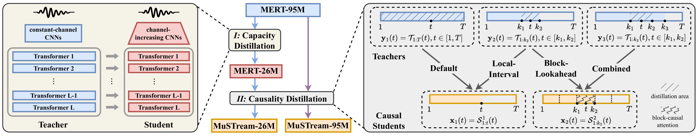

# MuSTream: A Streaming Music Representation for Online Music Understanding

> **TL;DR** MuSTream is a streaming music representation for online music
> understanding. A two-stage distillation (capacity, then causality) turns the
> non-causal MERT into causal streaming models of 26M, 95M and 330M parameters, which
> process audio as a stream and reach near-offline performance on chord recognition,
> beat and downbeat tracking and key detection, in real time on a CPU.



## Highlights

- **Real-time on a CPU.** One prediction every 0.2 s, with a block-wise KV cache
  instead of recomputing past context. On an Apple M1 CPU, MuSTream-26M runs at a
  real-time factor of 0.09 with 0.22 s latency, and MuSTream-330M at 0.35 with 0.29 s.
- **In-browser real-time interface.** The [demo page](#real-time-interface-for-music-understanding)
  streams chord, beat and key predictions while a song plays, with ONNX Runtime Web on
  your own device: nothing to install, and your audio is never uploaded.
- **Open-source checkpoints.** Six streaming backbones (26M / 95M / 330M, each with
  $p = 0$ and $p = 15$) and their chord, beat and key probes, in PyTorch and ONNX.
  The released backbones are distilled on the public MTG-Jamendo dataset.
- **Drop-in streaming features.** `extract_features.py` turns any audio file into
  75 fps MuSTream features through one streaming session, as in real-time use.
- **Reproducible.** Scripts for both distillation stages on MTG-Jamendo (splits
  included), probe training and evaluation in offline, chunked, sliding-window and
  streaming modes, and ONNX export.


## Quick Start

### Real-time interface for music understanding

Open **https://yamaha-research-mustream.static.hf.space**, choose a task (chord, beat, key or
all), upload a song and press *Start streaming*, or press *Try a sample*. It runs MuSTream-26M by default; the
models run in your browser and your audio is never uploaded. For larger models and
running the demo locally, see [`streaming-demo/README.md`](streaming-demo/README.md).

### Streaming representation extraction

Set up the environment with [uv](https://docs.astral.sh/uv/) and download the released
checkpoints into `mustream/ckpt/`:

```bash
git clone https://github.com/yamaha-research/MuSTream.git && cd MuSTream
uv sync && source .venv/bin/activate
hf download yamaha-research/MuSTream --local-dir mustream/ckpt
```

Extract streaming features from your own audio with a MuSTream backbone (`--model`
26M, 95M or 330M; `--variant` `r0` for $p = 0$ or `r15` for $p = 15$):

```bash
python mustream/extract_features.py song.wav --model 95M --variant r15
# -> features/song.npz: `features` [L, T, D] at 75 fps (L = 13, D = 768 for 95M)
```

From Python:

```python
import sys; sys.path.insert(0, "mustream")
from extract_features import load_backbone, load_audio, extract

model = load_backbone("mustream/ckpt/pytorch/backbone/streaming_95M_r15.ckpt", device="cuda")  # or "cpu"
features = extract(model, load_audio("song.wav"))     # torch.Tensor [L, T, D], 75 fps
```

For chord, beat and key predictions, training the backbones and probes, and
evaluation, see [`mustream/README.md`](mustream/README.md).

## More experiment results

- [`docs/understanding_performance.md`](docs/understanding_performance.md): the paper's
  results come from backbones distilled on internal data. The released checkpoints are
  distilled on the public MTG-Jamendo dataset; this page compares the two sets on all
  three tasks.
- [`docs/key_detection.md`](docs/key_detection.md): full key-detection results,
  including how fast and how stably the running key estimate converges.

## Repository

| Path | Contents |
|---|---|
| [`mustream/`](mustream/README.md) | The MuSTream code: backbones (`modeling/`), the two distillation stages (`train_mert_size_distill.py`, `train_mert_causal_distill.py`), MTG-Jamendo preparation (`data_processing/`), and feature extraction (`extract_features.py`). |
| [`mustream/chord_recognition/`](mustream/chord_recognition/README.md), [`beat_tracking/`](mustream/beat_tracking/README.md), [`key_detection/`](mustream/key_detection/README.md) | The three understanding tasks: LSTM probes, data loaders, training, offline / chunked / sliding / streaming inference and evaluation. |
| [`mustream/onnx_export/`](mustream/onnx_export/README.md) | Exports a streaming backbone and its probes to ONNX and runs them without PyTorch. |
| [`streaming-demo/`](streaming-demo/README.md) | The browser demo: real-time chord, beat and key recognition with ONNX Runtime Web. |
| [`docs/`](docs/) | Additional results and the overview figure. |

## License

Copyright 2026 Yamaha Corporation and the MuSTream authors.

- **Code**: the source code in this repository is licensed under the
  [GNU Affero General Public License v3.0](LICENSE) (AGPL-3.0), except for the
  third-party code listed under [Acknowledgement](#acknowledgement), which keeps its
  original license.
- **Models**: the released model weights (the MuSTream backbones and the chord, beat
  and key probes, in PyTorch and ONNX, at
  [yamaha-research/MuSTream](https://huggingface.co/yamaha-research/MuSTream)) are
  licensed under the
  [Creative Commons Attribution-NonCommercial 4.0 International License](LICENSE-MODEL)
  (CC BY-NC 4.0). They are granted for non-commercial research purposes only.

For commercial use of the code under other terms, or of the model weights, please
contact us.

## Acknowledgement

MuSTream builds on the following open-source code:

- [`mustream/modeling/moshi/`](mustream/modeling/moshi/) is vendored from
  [Moshi](https://github.com/kyutai-labs/moshi) (Kyutai), under the MIT License. 
- [`mustream/modeling/mert/`](mustream/modeling/mert/) is adapted from
  [MERT](https://github.com/yizhilll/MERT) (Apache License 2.0, see [`LICENSE`](mustream/modeling/mert/LICENSE)).
